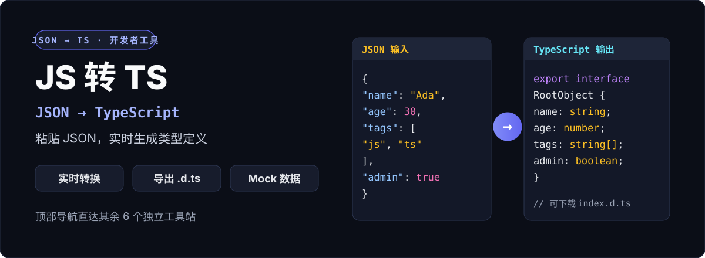
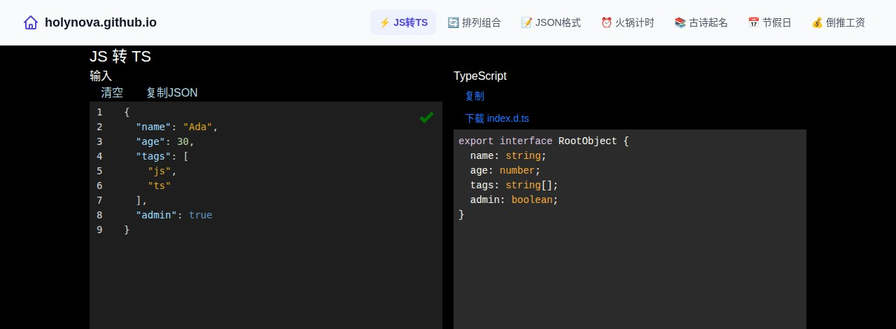

<p align="right"><a href="README.md">中文</a></p>

<p align="center">
  
</p>

<p align="center">
  <a href="https://json-to-ts.xiaosang.cc/">▶ Try Online</a>
  ·
  <a href="https://holynova.github.io/json_to_ts/">GitHub Pages Mirror</a>
  ·
  <a href="https://github.com/holynova/json_to_ts">GitHub Repository</a>
</p>

JS to TS converts JSON into TypeScript type definitions in the browser: paste JSON on the left, get `export interface` on the right in real time — copy it or download it as a `.d.ts` file. It also generates mock data from your input's shape and lets you download the generator code itself.

## Screenshot

<p align="center">
  
</p>

## Features

- **Live conversion**: converts as you type, using the `json-to-ts` library to infer types and adding an `export` prefix to every interface. Invalid input shows 「输入有错误, 请修改」 ("Input has errors, please fix it") instead of stale output.
- **Input editor**: a JSON editor with line numbers and syntax highlighting (Chinese UI), built-in sample data, and clear and copy-JSON buttons.
- **Export**: copy the generated TS code or download it as `index.d.ts`.
- **Mock data**: generates mock data matching your input's shape (Mock.js), with regenerate and download (`mockData.json`).
- **Take the generator with you**: download `main.ts` + `convert.ts` source to reuse the conversion logic in your own project.
- **Tool navigation**: the header links to 6 sibling tool sites — 排列组合 (Combinations), JSON 格式 (JSON Formatter), 火锅计时 (Hotpot Timer), 古诗起名 (Poem Namer), 节假日 (Holiday Visualizer), 倒推工资 (Salary Calculator) — each its own repo; this repo contains only the JS-to-TS tool.

> Note: the old README described 7 tools as 7 pages of one repo. They have since been split — this repo keeps only JS to TS; the other 6 tools are separate repos and separate sites, and the header nav links across sites.

## Run Locally

React + TypeScript + Vite, requires Node.js:

```bash
npm install
npm run dev      # Dev server
npm run build    # Type check + production build
npm run preview  # Preview the production build locally
```

Pushes to `master` are built and published to GitHub Pages automatically via GitHub Actions.

## Tech

- React 17 + TypeScript 4.4 + Vite 2 + Tailwind CSS + Ant Design 5.
- Conversion core: `json-to-ts` (type inference) + `react-json-editor-ajrm` (JSON editor) + Mock.js (mock data) + `react-syntax-highlighter` (code highlighting).
- The `docs/` directory keeps a historical build artifact (current production deploys come from the Actions build and don't read `docs/`).

```
index.html                  Entry
src/main.tsx                React entry
src/App.tsx                 Header + HomePage
src/components/Header/      Top nav (links to 7 tool sites)
src/pages/HomePage/         JS-to-TS main page: input / output / mock / download
src/pages/HomePage/template.ts   Downloadable generator code (main.ts + convert.ts)
src/utils/convert.ts        Mock data converter
src/common/components/      Shared copy / download / code-display components
```
