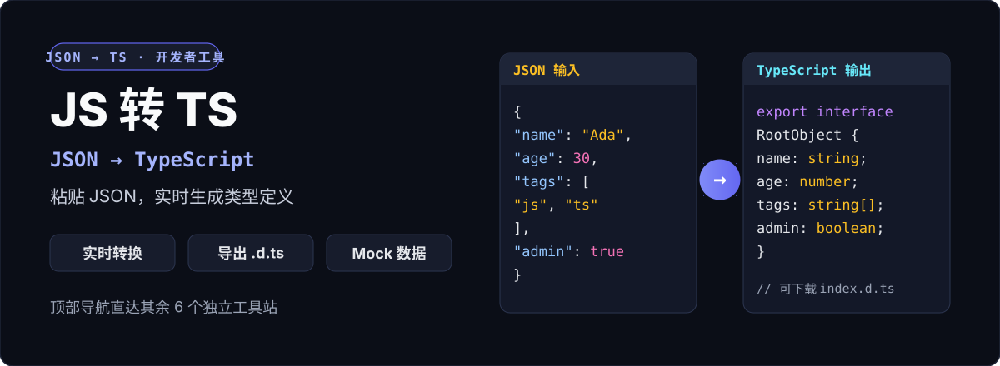
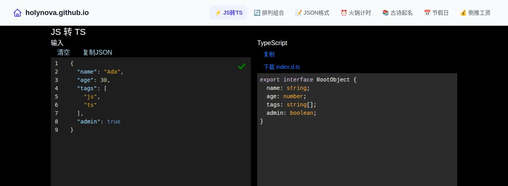

<p align="right"><a href="README.en.md">English</a></p>

<p align="center">
  
</p>

<p align="center">
  <a href="https://json-to-ts.xiaosang.cc/">▶ 在线使用</a>
  ·
  <a href="https://holynova.github.io/json_to_ts/">GitHub Pages 备用地址</a>
  ·
  <a href="https://github.com/holynova/json_to_ts">GitHub 仓库</a>
</p>

JS 转 TS 是一个在线 JSON 转 TypeScript 类型定义工具：左边粘贴 JSON，右边实时生成 `export interface`，可复制、可下载 `.d.ts` 文件。还附带 Mock 数据生成（按输入结构造假数据）和生成器代码下载（把转换逻辑带走自己用）。

## 截图

<p align="center">
  
</p>

## 功能

- **实时转换**：输入即转换，用 `json-to-ts` 库推导类型，自动给每个 interface 加 `export` 前缀；输入有错时提示「输入有错误, 请修改」。
- **输入编辑器**：带行号与语法高亮的 JSON 编辑器（中文界面），内置一份示例数据，支持清空与一键复制 JSON。
- **导出**：复制生成的 TS 代码，或下载为 `index.d.ts`。
- **Mock 数据**：按输入 JSON 的结构生成 Mock 数据（Mock.js），可重新生成、下载为 `mockData.json`。
- **下载生成器代码**：可下载 `main.ts` + `convert.ts` 两份源码，把转换逻辑带到自己的项目里。
- **工具导航**：顶部导航栏链接其余 6 个独立工具站——排列组合、JSON 格式、火锅计时、古诗起名、节假日、倒推工资（各为独立仓库，本仓只含 JS 转 TS）。

> 说明：旧版 README 曾把 7 个工具写成一个仓库的 7 个页面；现已拆分——本仓库只保留 JS 转 TS，其余 6 个工具已是独立仓库与独立站点，顶部导航是跨站链接。

## 本地运行

React + TypeScript + Vite，需要 Node.js：

```bash
npm install
npm run dev      # 开发服务器
npm run build    # 类型检查 + 生产构建
npm run preview  # 本地预览构建产物
```

推送到 `master` 后由 GitHub Actions 自动构建并发布到 GitHub Pages。

## 技术

- React 17 + TypeScript 4.4 + Vite 2 + Tailwind CSS + Ant Design 5。
- 转换核心：`json-to-ts`（类型推导）+ `react-json-editor-ajrm`（JSON 编辑器）+ Mock.js（Mock 数据）+ `react-syntax-highlighter`（代码高亮）。
- `docs/` 目录保留了一份历史构建产物（当前线上部署走 Actions 构建，不读 `docs/`）。

```
index.html                  入口
src/main.tsx                React 入口
src/App.tsx                 Header + HomePage
src/components/Header/      顶部导航（7 个工具站链接）
src/pages/HomePage/         JS 转 TS 主页面：输入 / 输出 / Mock / 下载
src/pages/HomePage/template.ts   可下载的生成器代码（main.ts + convert.ts）
src/utils/convert.ts        Mock 数据转换器
src/common/components/      复制 / 下载 / 代码展示公共组件
```
